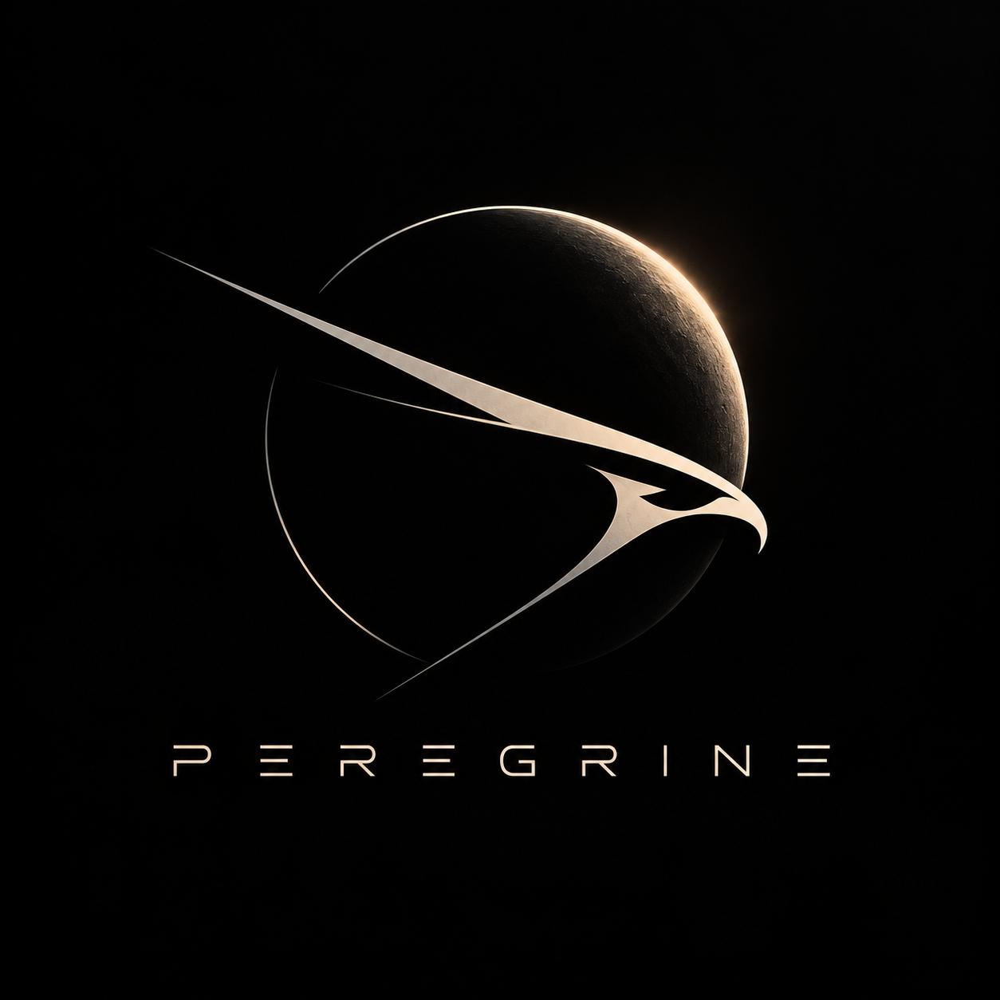

Peregrine

Training a language model from scratch.

I’ve spent a lot of time messing around with local LLMs, fine-tuning, and trying to squeeze models onto hardware they probably shouldn’t fit on. Eventually, I started wondering what it would take to build one myself.

So that’s what I’m doing.

Peregrine is my attempt at training a general-purpose language model from the ground up. The goal is a 14-billion-parameter model, Peregrine-14B, that can handle everyday tasks, reasoning, and programming without being built exclusively for any one of them.

It’s a pretty ambitious project, especially without a massive compute budget, but I want to see how far I can take it.

The idea

One thing I’ve been interested in is how the order of training data affects a model.

For example, if two models see the exact same amount of general text and code, will they perform differently depending on when they see that code?

What if one model trains on a consistent mix from beginning to end, while another starts with mostly general text and gradually introduces more programming data?

And would either approach make the model more resistant to losing performance when quantized?

That’s the main experiment behind Peregrine.

I want to find out whether changing the data mixture throughout training can produce a better model without increasing the total number of training tokens.

How I’m approaching it

Rather than throwing a massive dataset at a 14B model and hoping for the best, I’m starting small.

The plan is to run controlled experiments using smaller models, compare different training schedules, and use what I learn to decide how to train the larger model.

A few things I’m working on:

* Data pipeline: Keeping general text and programming data separate so I can control how much of each the model sees during training.
* Training: Using Google’s MaxText framework to train on TPUs, with the goal of eventually scaling to 14B parameters.
* Evaluation: Comparing models at the same training-token budgets to see which approaches actually work.
* Quantization: Testing checkpoints at lower precision, including 4-bit quantization, to see how much performance is lost and whether the training schedule makes a difference.

I’m also building tools to make dataset preparation and experimentation easier. Ideally, I want to be able to change the training recipe without rebuilding the entire dataset every time.

The model

The target is Peregrine-14B, a decoder-only transformer trained from scratch.

I want it to be a capable general-purpose model that can also write and understand code. Not a coding model that can barely hold a conversation, and not a chat model that falls apart when you give it a programming problem.

The exact architecture and training configuration aren’t finalized yet. I’d rather make those decisions based on the early experiments than lock everything in before I’ve tested anything.

Compute

I’m planning to apply for Google TPU Research Cloud to get the compute needed for the larger training runs.

14B is the goal, but it’s not guaranteed. If I can’t get enough compute, I’ll scale down to 8B or potentially 3B–4B.

I’d much rather finish training a smaller model properly than end up with a half-trained 14B model.

Current progress

This is still in the early stages.

I’ve started working on dataset preparation and have the prompt-generation script written. Right now, I’m building out the rest of the data pipeline and figuring out how I want to structure the experiments.

The next big step is getting the smaller training runs working, collecting actual results, and seeing whether the idea holds up.

There aren’t any pretrained weights or benchmark results yet. I’ll add those as they become available.

Why Peregrine?

I wanted a name that was simple, recognizable, and actually sounded like a model name.

Peregrine falcons are known for their speed and precision, which felt pretty fitting.

Plus, Peregrine-14B just sounds cool.

What’s next?

First, get the data pipeline working properly. Then train some smaller models, run the experiments, and hopefully learn enough to make the big training run worthwhile.

I don’t expect everything to work on the first try. A lot of this project is me figuring things out as I go, and that’s part of why I’m doing it.

If the research produces something interesting, great. If I end up learning a ridiculous amount about training language models in the process, that’s a win too.

⸻

Project Peregrine is an independent research and development project. Still very much a work in progress.
